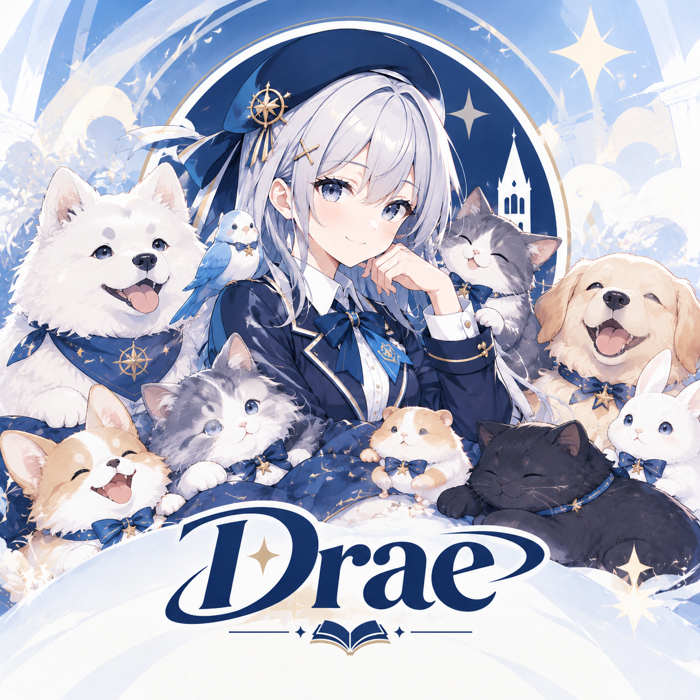

# Drae 宠物乐园

当前发布版本：**2.0.0**。

- [查看 2.0.0 Release 与更新说明](https://github.com/yuexl258/memgke-qq-pet/releases/tag/v2.0.0)
- [下载 Windows x64（含前后端）](https://github.com/yuexl258/memgke-qq-pet/releases/download/v2.0.0/drae-pet-2.0.0-windows-amd64.zip)
- [下载 Linux x64（含前后端）](https://github.com/yuexl258/memgke-qq-pet/releases/download/v2.0.0/drae-pet-2.0.0-linux-amd64.tar.gz)
- [完整更新日志](CHANGELOG_2.0.0.md) · [验证记录与已知限制](version/2.0.0/VALIDATION.md) · [SHA-256 校验](version/2.0.0/SHA256SUMS.txt)

福袋功能仍为试验性接入，完整后端测试存在未通过项目，详情见验证记录。

Drae 宠物乐园是一个面向 QQ 宠物的 Web 陪伴平台，提供宠物资料、日常照料、好友互动、宠物 PK、自动托管和乐园管理功能。项目采用 Vue 3 前端、Go 服务端和 SQLite 数据库，并通过 [萌卡 NT ](https://mengka.net/) 连接 QQ 宠物节点。

> [!IMPORTANT]
> 项目仍在持续开发，接口和数据结构可能调整。请在可信环境中保存 QQ 账号、Token、Cookie 和管理员凭据，并遵守所在地法律法规及相关平台服务协议。

## 服务器赞助商

### ☁️ 感谢鸿梦云对 Drae 宠物乐园的服务器赞助

**稳定服务器，让每一位伙伴都能安心回家。**

**[点击访问鸿梦云，获取云服务器支持](https://hmyun.com.cn/?i93d950)**

## 交流群

欢迎加入 Drae 宠物乐园交流群：**1130029070**

## 功能

### 用户端

- 注册、登录、会话恢复和密码修改
- QQ 账号绑定、登录、续期和安全验证
- 宠物资料、职业、状态、每日统计和战力排行
- 喂食、洗护、互动、学习、工作和冒险
- 好友列表、好友宠物资料和串门互动
- 宠物 PK，以及优先挑战可战胜好友的自动 PK
- 自动照料、自动喂食、自动洗护和被雇佣后自动召回
- 每日好友串门、活动记录、乐园公告和金币钱包

### 管理端

- 乐园总览
- 成员、角色、状态和钱包管理
- QQ 账号绑定、服务套餐和服务期限管理
- 金币卡密生成、查询和统计
- 乐园公告、消息提醒和操作日志
- 乐园设置、萌卡 NT 节点连接和服务状态

## 项目架构

~~~mermaid
flowchart LR
    B[浏览器] -->|HTTP / WebSocket| F[Vue 3 前端]
    F -->|REST API / 反向代理| S[Go 服务端]
    S -->|database/sql| D[(SQLite)]
    S -->|最新 NT API| M[萌卡 NT 节点]
    S -->|可选通知| Q[QQ 官方机器人]
~~~

发布版前端是一个轻量 Go 启动器，内嵌 Vue 构建产物，并将 /api、/healthz 和 /ws 请求代理到服务端。

## 技术栈

| 模块 | 技术 |
| --- | --- |
| 服务端 | Go、Chi、database/sql |
| 数据库 | SQLite（modernc.org/sqlite，无需 CGO） |
| 鉴权 | HttpOnly Cookie Session、bcrypt |
| 实时通信 | Gorilla WebSocket |
| 前端 | Vue 3、TypeScript、Vite |
| UI 与状态 | Element Plus、Pinia、Vue Router |

## 目录结构

~~~text
Drae-pet/
├─ backend/
│  ├─ cmd/server/                 # Go 服务端入口
│  ├─ internal/                   # 认证、管理、自动照料、自动 PK、节点适配和 API
│  └─ data/                       # 运行时数据库（不要提交）
├─ frontend/
│  ├─ public/                     # 品牌图标和静态资源
│  ├─ src/                        # API、组件、布局、路由、状态和页面
│  └─ package.json
├─ icon.png                       # Drae 宠物乐园品牌图标
└─ README.md
~~~

## 环境要求

- Go 1.26 或更高版本
- Node.js 20.19+ 或 22.12+
- npm

## 从源码运行

### 启动服务端

~~~powershell
cd backend
go mod download
go run ./cmd/server
~~~

首次启动会要求输入服务端监听地址、初始管理员用户名和密码。配置保存于 backend/data/qq-pet.db，后续启动会直接读取。

### 启动前端

~~~powershell
cd frontend
npm ci
npm run dev
~~~

浏览器访问 http://127.0.0.1:5173。开发代理默认将 /api、/healthz 和 /ws 转发到 http://127.0.0.1:2345。

## 发布版运行

~~~powershell
# 终端 1
./drae-pet-server.exe

# 终端 2
$env:FRONTEND_PORT = "5173"
$env:NO_OPEN = "0"
./drae-pet-frontend.exe
~~~

前端启动器支持 BACKEND_URL、FRONTEND_HOST、FRONTEND_PORT 和 NO_OPEN 环境变量。SQLite 默认写入服务端工作目录下的 ./data/qq-pet.db，请定期备份 data 目录。

## 构建

~~~powershell
cd backend
go build -trimpath -o drae-pet-server.exe ./cmd/server

cd ../frontend
npm ci
npm run build
go build -trimpath -ldflags "-s -w -X main.version=2.0.0" -o ../drae-pet-frontend.exe .
~~~

## Docker 部署

~~~powershell
Copy-Item .env.docker.example .env
# 编辑 .env，至少修改 ADMIN_PASSWORD
docker compose up -d --build
~~~

启动后访问 http://localhost:5173，后端 API 默认映射到 http://localhost:2345。停止服务：docker compose down。

## 测试

~~~powershell
cd backend
go test ./...

cd ../frontend
npm test
npm run build
~~~

后端测试覆盖认证、数据库迁移、钱包、服务端接口、自动照料和自动 PK 等核心模块；前端通过类型检查、单元测试和生产构建进行基础验证。

## 致谢

Drae 宠物乐园的 QQ 宠物接入基于 [萌卡 NT（Mengka-NT）](https://mengka.net/nt/api/)，感谢原项目作者及贡献者的开源分享。

特别感谢服务器赞助商 [鸿梦云](https://hmyun.com.cn/?i93d950) 对 Drae 宠物乐园的支持。

本仓库是独立实现，并非萌卡 NT 官方项目或官方分支。使用、修改或分发相关项目内容时，请分别遵守各自仓库的开源许可证；“QQ”等名称及相关商标归其权利人所有。

## 免责声明

本项目仅供学习、研究和技术交流使用，不提供可用性、稳定性或账号安全保证。使用者应自行承担部署和使用风险，并遵守所在地法律法规及相关平台服务协议。请勿将本项目用于破坏服务、侵犯他人权益或其他违法违规用途。

## 发布说明

由于 Drae 宠物乐园存在较多二开版本，为避免版本分散和维护困难，当前版本采用闭源方式发布；允许个人或团队进行合法运营，但请保留 Drae 宠物乐园品牌信息，并遵守相关法律法规及平台服务协议。
